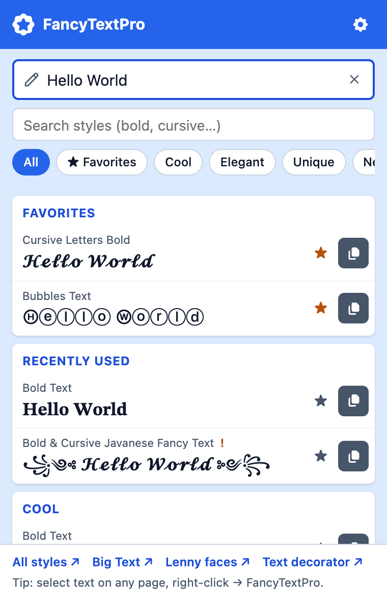
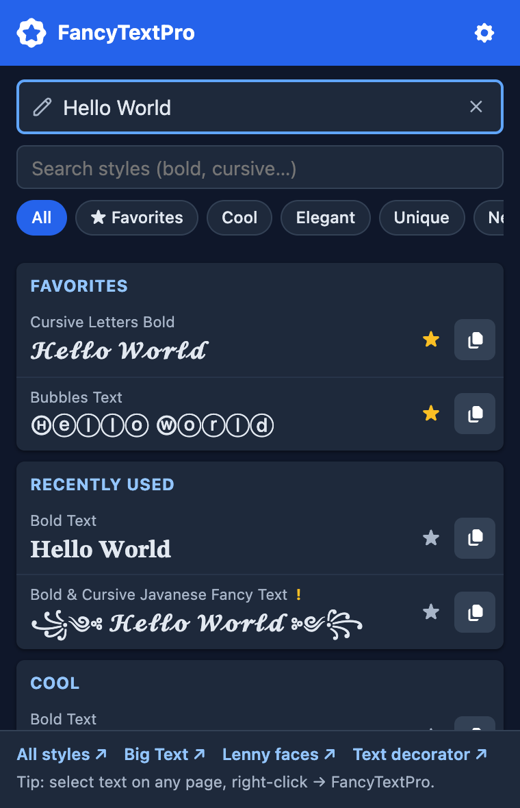

<p align="center">
  
</p>

<h1 align="center">FancyTextPro for Chrome & Firefox</h1>

<p align="center">
  <b>Fancy text anywhere you type.</b> Select text, right-click, and pick a style: 𝐛𝐨𝐥𝐝, 𝒸𝓊𝓇𝓈𝒾𝓋𝑒, ⓑⓤⓑⓑⓛⓔ, 𝔤𝔬𝔱𝔥𝔦𝔠, ɟlᴉd and 140+ more.<br />
  The official browser extension of <a href="https://www.fancytextpro.com">FancyTextPro.com</a>. Private by design, works offline.
</p>

<p align="center">
  
  &nbsp;
  
</p>

---

## Features

- **Right-click → restyle in place.** Select text in any editable field, then right-click → **FancyTextPro** → pick a style. The text is replaced where it is, and <kbd>Ctrl</kbd>+<kbd>Z</kbd> undoes it. If the text isn't editable, the styled version is copied instead.
- **Live preview in the menu (Firefox).** The right-click menu shows *your* selected text in each style. Chrome shows each style's name in that style.
- **Popup with live previews.** 141 styles across 15 categories, with search, category chips, and one-click copy.
- **Insert from the popup.** Opened over a text field, the popup can insert any style at the caret (↵ button or <kbd>Shift</kbd>+<kbd>Enter</kbd>).
- **Favorites and recently used.** Star the styles you use most. They show first in the popup *and* in the right-click menu.
- **Keyboard first.**
  - <kbd>Alt</kbd>+<kbd>Shift</kbd>+<kbd>F</kbd> opens the popup.
  - <kbd>Alt</kbd>+<kbd>Shift</kbd>+<kbd>L</kbd> re-applies your last style to the selection.
  - In the popup, <kbd>↑</kbd>/<kbd>↓</kbd> moves between styles, <kbd>Enter</kbd> copies, <kbd>F</kbd> favorites, and <kbd>/</kbd> jumps to search.
  - On macOS the shortcuts use <kbd>Ctrl</kbd> instead of <kbd>Alt</kbd>. All of them can be changed.
- **Remove styling.** Turns 𝐬𝐭𝐲𝐥𝐞𝐝 text back into plain text, from the right-click menu or the popup. It also means you can switch a selection from bold to italic without the two mixing.
- **Faithful to the website.** 135 styles are generated from FancyTextPro.com's own output and checked character-for-character by the test suite.
- **Honest hints.** Styles that use rare scripts are marked with **!** ("may not display on every device"). A tip reminds you to keep names and hashtags plain, because styled letters aren't searchable or screen-reader friendly.
- **Light and dark themes**, keyboard and screen-reader accessible (WCAG 2.2 AA, checked automatically).

### Privacy

FancyTextPro converts text **entirely on your device**:
- no network requests
- no analytics, telemetry or remote code
- no account

It can only see a page **when you use it there** (`activeTab`), and it asks for no access to "all websites". See [PRIVACY.md](PRIVACY.md).

| Permission | Why |
|---|---|
| `contextMenus` (Firefox: `menus`) | The FancyTextPro right-click menu |
| `storage` | Your favorites, recent styles and settings |
| `activeTab` | Read and replace the selected text in the current tab, and only after you click a FancyTextPro action |
| `scripting` | Run that one-off replacement |

None of these trigger an install warning.

## Install

| Browser | Status |
|---|---|
| Chrome (other Chromium browsers untested) | Chrome Web Store: [FancyTextPro](https://chromewebstore.google.com/detail/mokackbjpknbmpebgkieaoapkioeoehf). *This listing is being re-published; see [RELEASING.md](RELEASING.md).* |
| Firefox (140+) | addons.mozilla.org: *submission pending* |

**From source (developer mode):**

```bash
npm ci
```

```bash
npm run build
```

- **Chrome:** open `chrome://extensions`, turn on *Developer mode*, click *Load unpacked*, and pick `dist/chrome`.
- **Firefox:** open `about:debugging#/runtime/this-firefox`, click *Load Temporary Add-on…*, and pick `dist/firefox/manifest.json`.

## Development

Requires Node.js 20+.

| Command | What it does |
|---|---|
| `npm run dev` | Unminified build with sourcemaps into `dist/`, rebuilds on change |
| `npm run build` | Production builds: `dist/chrome`, `dist/firefox` |
| `npm test` | Unit tests (Vitest): engine, website parity, logic, injected page functions |
| `npm run test:e2e` | Builds a test variant and runs Playwright in real Chromium, including axe accessibility audits |
| `npm run typecheck` | TypeScript strict mode |
| `npm run lint:firefox` | `web-ext lint` (the same linter addons.mozilla.org uses) |
| `npm run size` | Bundle budget: ≤ 150 KB zipped (currently ~53 KB) |
| `npm run check` | All of the above except e2e |
| `npm run start:chrome` / `start:firefox` | Launch a clean browser profile with the extension loaded |
| `npm run package` | Store-ready zips and source archive in `web-ext-artifacts/` |
| `npm run store:assets` | Regenerate README screenshots and store images (`store/`) |
| `npm run styles:capture && npm run styles:derive` | Re-sync the style catalogue from FancyTextPro.com |

The first e2e run needs a browser: `npx playwright install chromium`.

### Project layout

```
src/
  engine/       Pure text engine: catalogue, transforms, "unstyle". No browser APIs.
    data/       site-styles.json, generated from FancyTextPro.com
  background/   Context menu, keyboard shortcuts, apply/insert logic
  inject/       Self-contained functions run in the page on demand
  popup/        Toolbar popup (vanilla TS + CSS)
  options/      Settings page
  welcome/      One-time welcome page shown on install
  shared/       Browser shim, storage, links + UTM, i18n, design tokens
  _locales/     UI strings
scripts/        Build, packaging, size budget, icons, screenshots, style sync
tests/          unit/ (Vitest) · e2e/ (Playwright) · fixtures/
docs/           Architecture, testing, screenshots
```

More detail is in [docs/ARCHITECTURE.md](docs/ARCHITECTURE.md). The test plan and manual site checklist are in [docs/TESTING.md](docs/TESTING.md).

## Project documents

- [Architecture](docs/ARCHITECTURE.md) · [Testing](docs/TESTING.md) · [Releasing](RELEASING.md) · [Store listing](store/LISTING.md) · [Security](SECURITY.md) · [Changelog](CHANGELOG.md)

## Contributing

Bug reports, new styles and translations are welcome. See [CONTRIBUTING.md](CONTRIBUTING.md).

## License

[MIT](LICENSE) © 2026 Atul Arvind. "FancyTextPro" and its logo are the project owner's branding. Please don't publish forks under that name.
